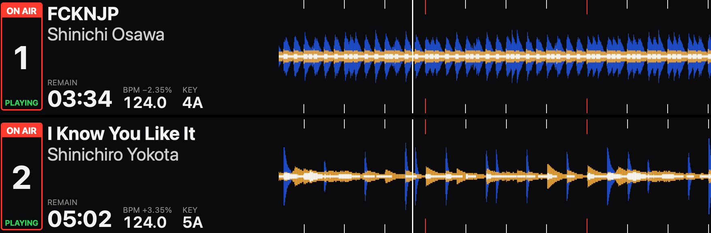
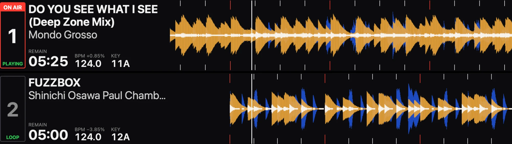

PioneerBox is a Raspberry Pi that sits in a DJ booth, wired into Pioneer DJ /
AlphaTheta gear. It does two jobs, and either one keeps working if the other
breaks:

- **It records the set,** with a tracklist that says when each track was fully
  on air.
- **It shows what's playing,** with track info and waveforms, on an iPad, a
  monitor, or later an LED board.

## What it does

**Recording.** Audio comes from the mixer's USB port or an analog output. It's
saved as a 320 kbps MP3 plus a lossless FLAC master, because an MP3 can't be
improved later. A recording survives a power cut, everything but the last 5
seconds, and dropped audio is counted, never ignored.

**The tracklist.** "Fully on air" is a written rule: the track is playing, the
mixer says it's audible, and, when the mixer sends fader data over MIDI, the
channel fader is up and the crossfader isn't cutting it, for 8 seconds. Tracks
I only cue in headphones never show up. It exports a `.cue` file, plain
timestamps, JSON, and chapters inside the MP3.

**The display.** The Pi serves web pages, so any browser can show them. The
booth view copies the layout of the XDJ-AZ's waveform screen: a row per deck
with on air and play state, time remaining, BPM, key, and a scrolling
three-band waveform with beat marks.

The audience view is made to be read from 3 meters away in a dark booth: album
art, title, artist, album and BPM, with the on-air track's waveform scrolling
across the bottom. Any track can be hidden from the display.

**It only listens.** The box never sends anything that loads, plays or syncs a
deck, never hands out addresses on the club network, and never takes a player
number a real deck needs. It can run its own Wi-Fi network so an iPad can open
the display in a club.

## How it was built

I wrote the spec with Claude: requirements with pass/fail criteria, an
architecture, a list of what's known about each piece of gear, a risk list and
a backlog of 33 tasks. The spec is mine and the build can't edit it. When the
agent disagrees with it, it writes a question for me instead.

Then a script ran Claude Code unattended, one task per session:

- **A fresh session for every task.** Each one reads the spec and its one task
  from scratch, so nothing depends on one long conversation holding up.
- **The script judges the work, not the model.** After each session the script
  runs the checks itself and makes sure a commit landed.
- **It stops when it's stuck.** Two sessions with no commit, or the checks
  failing three times in a row, and the loop stops and waits for me.
- **The sandbox is the boundary.** Nobody is there to approve anything, so
  every command runs in Claude Code's sandbox: it can only write inside the
  repo, only reach the package registries, and can't see my credentials or my
  rekordbox library. The harness and the spec are write-protected, and the loop
  stops if they change anyway.
- **Never invent hardware behavior.** If a fact about a real device isn't
  written down with a source, the code has to cope either way, and the
  question goes on a checklist for me to run at the decks.

All 33 tasks were done in two days, with no hardware. The tests run against a
made-up set with a known right answer, built to include the tricky cases: a
track only cued in headphones, a long blend, a crossfader cut, and the same
track played twice.

## On real gear

The first hardware test was an XDJ-AZ plugged into a Pi 3B+, with Claude
working over SSH and me at the decks. The XDJ-AZ showed up as a USB audio
device with no driver changes, and a one-minute recording came out with zero
dropouts and the right tracklist.

It also found two bugs the tests couldn't. The recorder mistook a folder the
system mounts for a USB drive and couldn't write to it, and reinstalling kept
the old code because the version number never changed. Both are fixed. And the
first USB cable I tried was charge-only.

## What changed along the way

- **The booth view was redone from a photo.** I sent a photo of the XDJ-AZ's
  screen, and the booth view became a row per deck with the playhead near the
  left. That left two lines of the spec out of date, so the agent wrote them up
  as questions for me instead of working around them.
- **Wi-Fi for iPads.** The spec said no DHCP server. I decided the box can hand
  out addresses on its own Wi-Fi, never on the wired network the decks use.
  The Wi-Fi password is a simple default for my own box, and it's flagged to
  change before anyone else gets one.
- **Artwork only when it's real.** A track with no artwork shows no picture,
  not generic placeholder art.

## Still to come

More hardware checklists: reading the decks over the network, MIDI from the
mixer, a 3-hour recording on a Pi 3, analog input, and other mixers. A
flashable SD card image is built but hasn't booted on a Pi yet. After that, an
LED board.
